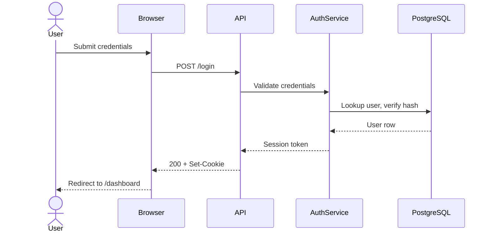

## Documentation-as-Code Rules

Documentation must be maintained as part of implementation work.

When a change introduces or modifies a meaningful feature, integration, provider, workflow, architectural pattern, configuration model, or operational process, the agent must either:

1. create or update the nearest relevant `.md` file, or
2. explicitly state why no documentation change was necessary.

Documentation should live close to the code it explains.

Do not create a large root-level documentation folder unless the documentation applies globally.
The solution-root `docs/` directory (see `.agents/standards/repository-structure.md`) is the
defined exception: current-state, solution-wide documentation only — architecture, topology,
component and integration overviews — never work-item planning or low-level requirements.

Preferred pattern:

```
src/
└── Payments/
├── PaymentProviderFactory.cs
├── MockPaymentProvider.cs
└── README.md
```

Documentation must be:
- concise,
- practical,
- implementation-specific,
- useful to future maintainers,
- linked to official external documentation when relevant.

Avoid:
- repeating obvious code behavior,
- documenting every class,
- long essays,
- stale implementation speculation,
- duplicating information already covered elsewhere.

Each feature/integration README should include only the sections that apply:

```
# < Feature or Component Name >

## Last Updated

YYYY-MM-DD

## Purpose

Briefly explain what this component does.

## Key Files

List the most important files.

## Design Notes

Explain important implementation choices.

## External References

Link to official documentation for external services/packages.

## Local Development / Mocking

Explain how to run or test this locally.

## Operational Notes

Mention configuration, secrets, migrations, jobs, queues, or risks.

```

README files should remain concise.

If a README exceeds ~300-500 lines or covers multiple unrelated concerns,
split the content into focused markdown files located nearby.

Example:

```
src/Payments/
├── README.md
├── provider-selection.md
├── local-development.md
├── stripe-notes.md
└── mock-provider.md
```

README.md should act as the entry point and index.

---

## Context pack maintenance

The `.agents/context/` directory is the one **deliberate exception** to the
"documentation lives close to the code" rule above: it is a small, central pack
that orients a contributor (human or agent) at the start of a session. Because no
single code change lives *near* it, the nearest-`.md` trigger never points here —
so the pack must be maintained by explicit trigger, or it silently goes stale.

Keep it current as part of the work that invalidates it:

- a new or changed build/run/test command → `tech-quickref.md`;
- a shift in where the active work is concentrated → `current-focus.md`;
- a new domain term an outsider would not know → `glossary.md`;
- a structural change to how subsystems fit together → `operational-map.md`.

`current-focus.md` is the file most prone to drift, because priority shifts are
not tied to any one commit. It is gardened at milestone boundaries (see
`agent-workflow.md`) rather than per task.

For what belongs in the pack, the per-file template, and the sizing/lifecycle
rules, see `.agents/context/README.md` and `.humans/writing-context.md`. Do not
duplicate code, schema, full ADRs, specs, or plans into the pack — reference them.

---

## Documentation Scope Control

Documentation updates should describe durable knowledge, not temporary implementation steps.

Document:
- integration decisions,
- local development usage,
- configuration requirements,
- mock/fake provider behavior,
- operational risks,
- important trade-offs.

Do not document:
- obvious method behavior,
- temporary debugging notes,
- implementation details likely to change immediately,
- information already clear from names or tests.

---

## Diagrams

Architecture, sequence, data-flow, state, and domain-model diagrams in this repository must be expressed in [Mermaid](https://mermaid.js.org/), embedded directly in the relevant Markdown file as a fenced ` ```mermaid ` code block. Do not use exported image files (PNG, SVG, JPG) for diagrams that describe the system's structure.

### Why Mermaid

- Diagrams live next to the code they describe and travel with it through version control.
- Changes appear in PR diffs as text, not as opaque binary blobs.
- Agents and humans can read and update them without leaving the repo.
- They render natively on Gitea and GitHub; READMEs and ADRs updated through the agent workflow stay visually current.

### Where diagrams live

- **Architecture overview** — `docs/` for a solution-wide overview (see
  `.agents/standards/repository-structure.md`), the repo-root README, or a subsystem README.
- **Sequence diagrams** for non-trivial request flows or cross-service integrations — in the relevant subsystem README, or in the Feature-level plan or item `spec.md` (see `.agents/specs/README.md`) when scoped to a single feature or item.
- **State diagrams** for workflows and entity lifecycles — alongside the code that implements them.
- **ER / domain-model diagrams** — in `.agents/specs/<feature-slug>/domain-model.md` when a feature introduces or significantly reshapes domain entities.
- **Within an ADR** when the decision is about structural shape (a layering choice, an integration pattern, a partition strategy). Embed the diagram in the ADR body — it is part of the historical record.

In a feature/integration README, diagrams normally belong in the *Design Notes* section.

### Diagram types and when to use them

| Mermaid type | Use for |
|---|---|
| `flowchart` | Architecture overviews, data flow, decision flow. |
| `sequenceDiagram` | Request flows, integrations, async message exchanges. |
| `stateDiagram-v2` | Workflows, entity lifecycles, finite state machines. |
| `erDiagram` | Domain models, persistence schema relationships. |
| `classDiagram` | Type hierarchies, class relationships when prose is insufficient. |

Use the simplest type that fits. A `flowchart` is often clearer than a `classDiagram` for the same information.

### Currency rule

A diagram is part of the contract for the area it describes. When an architectural change happens, the diagram is updated **in the same PR**, not in a follow-up. A diagram that has drifted from reality is worse than no diagram — it actively misleads. The agent workflow (root `AGENTS.md`) enforces this through both the documentation-update step and the completion checklist.

### Naming and labelling conventions

- A short Markdown heading above the diagram code block names what the diagram shows.
- Node and edge labels are human-readable, not abbreviated. "Submit order" beats "subOrd". The repo is not space-constrained.
- Prefer **left-to-right** flow (`flowchart LR`) for architecture overviews and request flows; **top-to-bottom** (`flowchart TD`) for hierarchies and lifecycles.
- Keep each diagram focused on one question. If a diagram has more than a screenful of nodes, split it into multiple focused diagrams with separate headings.

### Legible in dark mode

Assume every Mermaid diagram and Markdown file will be read in an editor using a dark theme, unless the file says otherwise. Colours and styling must be clear against a dark background. That covers `classDef` and `style` fills, strokes and text, link colours, `%%{init}%%` theme variables, and any highlighting in Markdown such as inline HTML colour or emphasis that relies on colour.

- Prefer Mermaid's default theme colours over hard-coded ones. A renderer that follows the editor's theme switches the defaults for a dark background; it cannot switch a colour you hard-coded.
- When you set a fill, also set a text colour (`color:`) that contrasts with it. Do not rely on the default text colour, which a dark theme may change to light-on-light.
- Avoid pale fills paired with default text, black or near-black strokes and text, and colour as the only way to tell elements apart. Pair colour with a label, shape or line style.
- A diagram meant only for a light background, such as one exported for a printed document, says so in the heading or a comment above it.

### Example

````markdown
### Login request flow


````

### Rendering on Azure DevOps

Azure DevOps' Markdown renderer has had inconsistent Mermaid support across releases. When a diagram must render on ADO, verify in the target environment before relying on it. In the rare case Mermaid does not render reliably for a particular diagram, attach a rendered image export alongside the source — but always keep the Mermaid source. The image is a derived artifact; the Mermaid block is the source of truth.

---

## Architecture Decision Records

Architecture Decision Records live in `.agents/adrs/`. Significant architectural decisions must be captured as an ADR. Routine implementation choices that affect only one item should be recorded directly in that item's own `spec.md` instead (see `.agents/specs/README.md`).

The ADR format is mandatory: every ADR uses Michael Nygard's structure (Context → Decision → Consequences) extended with Date, Status, Options Considered, Rationale, and Related Documentation. The starting point for a new ADR is `.agents/adrs/TEMPLATE.md`. Do not invent alternative structures or omit sections.

Cross-referencing is required:

- Every cross-cutting Plan (`.agents/plans/<slug>.md`, per `.agents/standards/plans.md`) and every Feature-level plan or item `spec.md` must cite the ADRs whose decisions constrain its design. A cross-cutting Plan cites them in *Context and Orientation* or *Interfaces and Dependencies*; a Feature-level plan or item spec cites them wherever relevant.
- Every ADR that supersedes a prior ADR must cite the prior ADR in its *Context* and update the prior ADR's *Status* to `Superseded by NNNN`.
- Code-level READMEs should cite ADRs in their *Design Notes* section when the component embodies a non-obvious architectural choice.
- **Cite an ADR by a Markdown link to its file, never by a bare number in prose.** A bare number cannot say which decision is meant if a number was ever reused, so "ADR-0005" may not identify one decision. Never delete an ADR or reuse a number; both are gate-enforced. See `.agents/adrs/README.md` → *ADRs are never deleted* and *Citing an ADR*.

For the full set of triggers, the status lifecycle, the naming convention (`NNNN-short-decision-name.md`), and the rules for updating versus superseding, see `.agents/adrs/README.md`.
