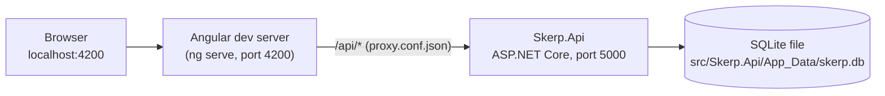

# Development environment

Everything runs on the contributor's machine. There is no shared environment: the solution is for
local demonstration only (Deliverable AB#1427), and `main` is where work is verified after merge.

## Processes and ports

| Process | Started by | Port | Notes |
|---|---|---|---|
| Angular dev server | `npm start` in `client/` → `ng serve` | 4200 | Serves the client and proxies `/api` (every API version) to the API. `/swagger`, `/health` and `/alive` are not proxied; open them on port 5000 |
| Skerp.Api | `npm start` in `client/` → `dotnet run --project ../src/Skerp.Api --launch-profile http` | 5000 | `ASPNETCORE_ENVIRONMENT=Development` from `launchSettings.json` |

The ports are the framework defaults, confirmed by Tyler Pieterse on 2026-10-22. To change one, also
update `client/proxy.conf.json`, `src/Skerp.Api/Properties/launchSettings.json`, the root `README.md` and
this file.

## Data

- SQLite, through EF Core code-first migrations in `src/Skerp.Infrastructure/Persistence/Migrations`.
- The API migrates and seeds on every start (`DatabaseInitializer`); both steps are safe to repeat.
- Timestamps are stored as UTC ISO 8601 text. A `skerp.db` created before the PR 728 review (UTC ticks, migration
  `20261023070746_AddPurchaseOrders`) cannot be migrated: delete the file and let the API recreate it.
- A relative `Data Source` resolves against the API's content root, so the file location does not depend
  on the directory the API was started from.

## Configuration

Every key the solution reads is listed in [`../config/env-variables.md`](../config/env-variables.md).
